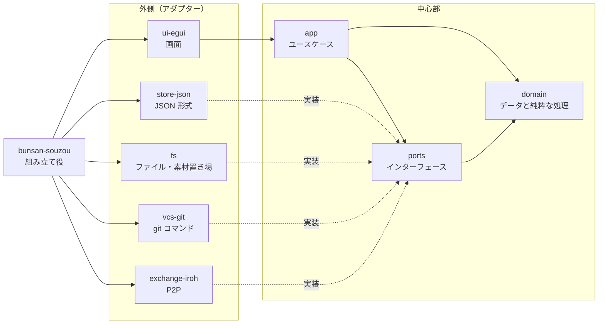
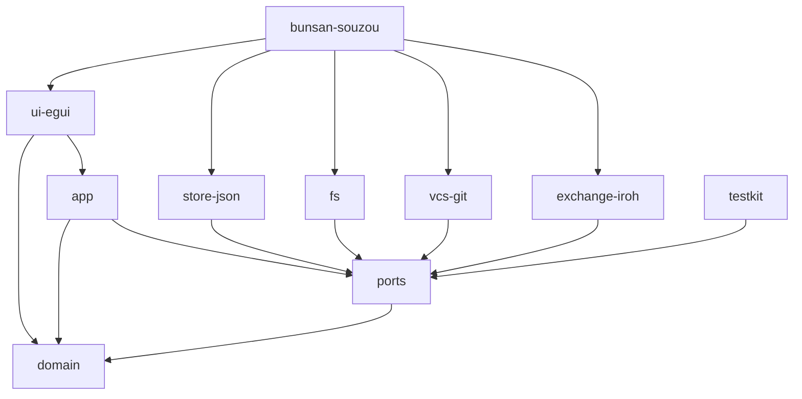

# 全体構成（アーキテクチャ）

v0.1.0 のプログラム全体を、どのような部品に分け、部品どうしをどうつなぐかを定めます。各部品の詳細は [modules/](modules/) に、主な操作の流れは [シーケンス図](sequences.md) にあります。

## 1. 方針：ポートとアダプター

外の世界（ファイル・git・P2P・画面）とのやりとりを、**インターフェース（ポート）**と**実装（アダプター）**に分けます。

- **ポート**：外の世界に「何をしてほしいか」を表すトレイト。中心部の言葉（履歴更新・分岐・素材の公開など）で書きます。
- **アダプター**：ポートを、具体的な技術（JSON・ファイル・git コマンド・Iroh）で実装したもの。
- **中心部**（ドメインとユースケース）は、ポートのトレイトだけを知り、アダプターを知りません。
- アダプターを組み合わせるのは、起動処理（組み立て役）だけです。



この形にすると、次のことができます。

- **差し替え**：P2P の仕組みや保存形式を変えても、中心部は変わりません。
- **テスト**：中心部は、メモリ上で動く偽物の実装（テスト用アダプター）と組み合わせてテストできます。git や通信がなくても動きます。
- **関心の分離**：JSON の書き方は store-json だけ、git の使い方は vcs-git だけが知っています。

## 2. クレート構成

モジュールではなく**クレート**で分けます。クレートは、`Cargo.toml` に書いた依存先しか使えないので、依存の規則（3 節）をコンパイラが守らせてくれます。

```
Cargo.toml                 … ワークスペースの定義
crates/
├── domain/                … データと純粋な処理（座標計算・当たり判定・編集操作）
├── ports/                 … インターフェース（トレイト）と、やりとりするデータの型
├── app/                   … ユースケース（作品の編集・保存・履歴・素材）
├── store-json/            … 作品の保存形式（JSON）。ports::WorkRepository の実装
├── fs/                    … ファイルの読み書きと素材置き場。ports::FileSource など の実装
├── vcs-git/               … git コマンドによる履歴管理。ports::VersionControl の実装
├── exchange-iroh/         … Iroh による素材の受け渡し。ports::AssetExchange の実装
│   └── examples/spike.rs  … P2P の検証用プログラム（M0）
├── ui-egui/               … 画面（egui）
├── testkit/               … テスト用の偽物の実装（開発時だけ使う）
└── bunsan-souzou/         … 実行ファイル。全部を組み立てて起動する
```

| クレート | 詳細 | 主な外部クレート |
| --- | --- | --- |
| domain | [modules/domain.md](modules/domain.md) | blake3、uuid（ID の型のみ） |
| ports | [modules/ports.md](modules/ports.md) | thiserror |
| app | [modules/app.md](modules/app.md) | （なし） |
| store-json | [modules/store-json.md](modules/store-json.md) | serde、serde_json |
| fs | [modules/fs.md](modules/fs.md) | image（PNG の検査）、dirs |
| vcs-git | [modules/vcs-git.md](modules/vcs-git.md) | （標準ライブラリのみ） |
| exchange-iroh | [modules/exchange-iroh.md](modules/exchange-iroh.md) | iroh、iroh-blobs、tokio |
| ui-egui | [modules/ui-egui.md](modules/ui-egui.md) | eframe（egui）、image、rfd |
| testkit | [modules/testkit.md](modules/testkit.md) | （なし） |
| bunsan-souzou | 本文書の 5 節 | anyhow、uuid（ランダムなコマ ID） |

## 3. 依存の規則



| クレート | 依存してよい先 |
| --- | --- |
| domain | 外部の純粋なライブラリだけ（ファイル・通信・画面を扱うものは使わない） |
| ports | domain |
| app | domain、ports |
| アダプター（store-json・fs・vcs-git・exchange-iroh） | domain、ports |
| ui-egui | domain、app |
| testkit | domain、ports |
| bunsan-souzou | すべて |

- アダプターどうしは依存しません。たとえば vcs-git は store-json を知りません。過去の状態を表示するときは、vcs-git が過去のファイルを読む手段（`FileSource`）を提供し、app がそれを store-json に渡します（[シーケンス図 S6](sequences.md#s6-過去の状態を見る)）。
- ui-egui は ports もアダプターも知りません。app のユースケースだけを呼びます。

## 4. 用語とコード上の名前

画面の用語（[構想](../vision.md) 3 章）と、コード上の名前を次のように対応させます。

| 画面の用語 | コード上の名前 |
| --- | --- |
| 作品 | `Work` |
| コマ割り | `Layout` |
| コマ（枠） | `Panel` / `Frame` |
| コマ内容 | `PanelContent` |
| 表示範囲（トリミング） | `View` |
| 線 | `Stroke` |
| 貼った素材 | `PlacedAsset` |
| 素材 | `Asset`（識別は `AssetHash`） |
| 素材 ID（P2P で受け渡す文字列） | `AssetTicket` |
| 履歴 | `Revision` |
| 履歴更新 | `record` |
| 履歴系統 | `Line` |
| 履歴分岐 | `branch_off` |
| 履歴統合 | `integrate` |
| アップロード | `upload` |
| 初回ダウンロード | `download_initial` |
| 継続ダウンロード | `download_more` |

## 5. 組み立て役（bunsan-souzou）

`main` 関数で、アダプターを作ってユースケースに渡し、画面を起動します。どの実装を使うかを知っているのは、ここだけです。

```rust
fn main() -> anyhow::Result<()> {
    let ports = AppPorts {
        repository: Arc::new(JsonWorkRepository::new()),
        files: Arc::new(FsFileAccess::new()),
        vcs: Arc::new(GitFactory::new()),
        library: Arc::new(FsAssetLibrary::open_default()?),
        exchange: Arc::new(IrohAssetExchange::start()?),
        ids: Arc::new(RandomIdSource),
    };
    ui_egui::run(Workspace::new(ports))
}
```

## 6. スレッドの扱い

- 画面は 1 本のスレッド（画面スレッド）で動きます。作品の状態（`Session`）は画面スレッドだけが持ちます。
- 時間のかかる操作（アップロード・ダウンロード・素材の公開と受け取り）は、ui-egui の**作業スレッド**で実行します。作業中は作品を編集できない状態（`Busy`）にし、終わったら結果を画面スレッドへ返します（[ui-egui 4.3](modules/ui-egui.md#43-バックグラウンド処理)）。
- そのため、ポートのトレイトはすべて `Send + Sync` とし、メソッドは**終わるまで待つ形（同期）**で定義します。非同期処理が必要な Iroh は、アダプターの内部で tokio を動かし、外には同期の形で見せます（[exchange-iroh](modules/exchange-iroh.md)）。

## 7. エラーの扱い

- 各ポートは、自分のエラー型を持ちます（`StoreError`・`VcsError`・`LibraryError`・`ExchangeError`）。エラー型は「利用者にどう伝えるか」で分類し、技術の詳細（git の標準エラー出力など）は付加情報として持ちます。
- app は、ポートのエラーをまとめた `AppError` を返します。
- ui-egui は、`AppError` を利用者向けの文に変えて状態表示に出します。

## 8. テストの方針

| 対象 | 方法 |
| --- | --- |
| domain | 単体テスト。座標変換・当たり判定・編集操作を、入力と出力だけで確かめる |
| app | testkit の偽物の実装と組み合わせて、ユースケースの流れを確かめる（ファイル・git・通信は使わない） |
| store-json | 保存して読み込むと元に戻ること、同じデータからは同じバイト列ができること |
| fs | 一時フォルダで、原子的な書き込みと素材置き場を確かめる |
| vcs-git | 一時フォルダに本物のリポジトリを作り、履歴更新・分岐・統合・競合を確かめる。git の出力を読む関数は、文字列を与えて単体テストする |
| exchange-iroh | 検証用プログラムで、同じ PC の 2 つのプロセス間の受け渡しを手動で確かめる |
| ui-egui | 道具（`Tool`）は egui に依存しない形にし、マウス操作の列を与えて、出てくる編集コマンドを確かめる |
