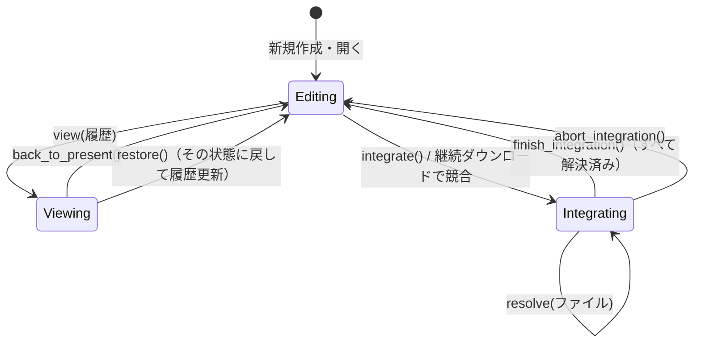

# app：ユースケース

| 項目 | 内容 |
| --- | --- |
| クレート | `crates/app` |
| 依存してよい先 | domain、ports |
| 対応する要件 | R-001〜R-051 のうち、画面からの操作すべて |

## 1. 責務

- 画面（ui-egui）から呼ばれる操作の窓口になる。
- domain の編集操作と、ports のインターフェースを組み合わせて、1 つの操作を完結させる（例：履歴更新 = 保存 → 作者の確認 → 履歴更新）。
- 作品の状態（編集中・過去の表示中・統合中）を管理する。
- どの実装（JSON・git・Iroh）が使われているかは知らない。

## 2. 型

### 2.1 ポートの束

```rust
/// アプリケーションが使うポート。組み立て役（bunsan-souzou）が作って渡す。
#[derive(Clone)]
pub struct AppPorts {
    pub repository: Arc<dyn WorkRepository>,
    pub files: Arc<dyn FileAccess>,
    pub vcs: Arc<dyn VersionControlFactory>,
    pub library: Arc<dyn AssetLibrary>,
    pub exchange: Arc<dyn AssetExchange>,
    pub ids: Arc<dyn IdSource>,
}
```

### 2.2 窓口

| 型 | 役割 |
| --- | --- |
| `Workspace` | 作品を開く前の操作（環境の確認、新規作成、開く、初回ダウンロード）と、素材の操作の入口 |
| `Session` | 開いている 1 つの作品の操作（編集、保存、履歴、履歴系統、アップロード・ダウンロード） |
| `AssetService` | 素材の操作（取り込み、一覧、公開、受け取り） |
| `*Job` | 時間のかかる操作。`run()` を作業スレッドで呼ぶ（[4 節](#4-時間のかかる操作)） |

### 2.3 編集コマンド

画面の道具は、マウス操作を編集コマンドに変えて `Session::edit` に渡します。編集コマンドは domain の編集操作に 1 対 1 で対応します。

```rust
pub enum EditCommand {
    // コマ割り
    AddPanel { frame: Rect },
    RemovePanel { panel: PanelId },
    MovePanel { panel: PanelId, delta: Point },
    ResizePanel { panel: PanelId, corner: Corner, to: Point },
    ReorderPanel { panel: PanelId, toward: Reorder },
    PanView { panel: PanelId, delta: Point },
    ZoomView { panel: PanelId, factor: f32, anchor: Point },
    // 線
    StartStroke { panel: PanelId, at: Point },
    ExtendStroke { at: Point },
    EndStroke,
    Erase { panel: PanelId, from: Point, to: Point },
    // 貼った素材
    PlaceAsset { panel: PanelId, hash: AssetHash },
    MoveAsset { panel: PanelId, index: usize, delta: Point },
    ScaleAsset { panel: PanelId, index: usize, corner: Corner, to: Point },
    RemoveAsset { panel: PanelId, index: usize },
}
```

座標はすべてページ座標です。画面座標からの変換は ui-egui が行います。

### 2.4 作品の状態

```rust
pub enum Mode {
    Editing,
    Viewing { revision: Revision, work: Work },    // 過去の状態を表示中（編集できない）
    Integrating { conflicts: Vec<RelPath> },       // 統合の競合を解決中
}
```



### 2.5 エラー

```rust
pub enum AppError {
    ReadOnly,             // 過去の表示中・統合中に編集しようとした
    IdentityRequired,     // 履歴更新の前に作者名とメールアドレスが必要
    UnrecordedChanges,    // 履歴更新していない変更があり、切り替え・統合できない
    UnresolvedConflicts(Vec<RelPath>),
    TicketMismatch,       // 受け取った素材のハッシュ値が素材 ID と違う
    Edit(EditError),
    Store(StoreError),
    File(FileError),
    Vcs(VcsError),
    Library(LibraryError),
    Exchange(ExchangeError),
}
```

## 3. 関数

### 3.1 Workspace

| 関数 | 内容 | 要件 |
| --- | --- | --- |
| `Workspace::new(ports: AppPorts) -> Workspace` | 作る | ― |
| `check_environment(&self) -> Result<String, AppError>` | 履歴管理の道具（git）が使えるか確かめ、版を返す | R-101 |
| `create_work(&self, dir: &Path) -> Result<Session, AppError>` | フォルダを作品にし、空の作品を保存して、履歴管理を始める | R-050 |
| `open_work(&self, dir: &Path) -> Result<Session, AppError>` | 作品を読み込む | R-050 |
| `prepare_download_initial(&self, from: RemoteUrl, dest: PathBuf) -> InitialDownloadJob` | 初回ダウンロードの準備 | R-045 |
| `assets(&self) -> AssetService` | 素材の操作の入口 | ― |

### 3.2 Session：表示と編集

| 関数 | 内容 | 要件 |
| --- | --- | --- |
| `work(&self) -> &Work` | 表示する作品（過去の表示中はその時点の作品） | ― |
| `mode(&self) -> &Mode` | 状態 | ― |
| `is_dirty(&self) -> bool` | 保存していない変更があるか | 仕様書 2.3 |
| `edit(&mut self, cmd: EditCommand) -> Result<(), AppError>` | 編集する（[A9](#a9-編集と変更の記録)） | R-001〜R-021 |
| `save(&mut self) -> Result<(), AppError>` | 変わったファイルだけを保存する（[A10](#a10-保存)） | R-014・R-022・R-051 |
| `asset_bytes(&self, hash: &AssetHash) -> Result<Vec<u8>, AppError>` | 素材のバイト列を、作品フォルダ → 素材置き場の順に探して返す（画面の表示用。初回ダウンロードした作品の素材は作品フォルダにだけある） | R-022 |

### 3.3 Session：履歴

| 関数 | 内容 | 要件 |
| --- | --- | --- |
| `set_identity(&self, identity: &Identity) -> Result<(), AppError>` | 作者名とメールアドレスを設定する | 仕様書 7.1 |
| `record(&mut self, message: &str) -> Result<RecordOutcome, AppError>` | 保存してから履歴更新する（[A11](#a11-履歴更新)） | R-040 |
| `revisions(&self, limit: usize) -> Result<Vec<Revision>, AppError>` | 履歴の一覧 | R-041 |
| `view(&mut self, revision: &Revision) -> Result<(), AppError>` | 過去の状態を表示する | R-042 |
| `back_to_present(&mut self)` | 今の状態の表示に戻る | R-042 |
| `restore(&mut self) -> Result<(), AppError>` | 表示中の過去の状態に戻し、新しい履歴を作る（[A12](#a12-この状態に戻す)） | R-042 |

### 3.4 Session：履歴系統

| 関数 | 内容 | 要件 |
| --- | --- | --- |
| `lines(&self) -> Result<(Vec<LineName>, LineName), AppError>` | 履歴系統の一覧と今の履歴系統 | R-043 |
| `branch_off(&mut self, name: &str) -> Result<(), AppError>` | 保存してから分岐する。保存した変更は新しい履歴系統に持ち越す | R-043 |
| `switch_line(&mut self, name: &LineName) -> Result<(), AppError>` | 切り替えて作品を読み直す（[A13](#a13-切り替えと統合の前提)） | R-043 |
| `integrate(&mut self, from: &LineName) -> Result<IntegrateOutcome, AppError>` | 統合する。競合したら `Integrating` になる（[A14](#a14-統合と競合の解決)） | R-044 |
| `resolve(&mut self, path: &RelPath, side: Side) -> Result<(), AppError>` | 競合したファイルをこちら／あちらに決める | R-044 |
| `finish_integration(&mut self) -> Result<(), AppError>` | 統合を完了して作品を読み直す | R-044 |
| `abort_integration(&mut self) -> Result<(), AppError>` | 統合を中止して作品を読み直す | R-044 |

### 3.5 Session：アップロードとダウンロード

| 関数 | 内容 | 要件 |
| --- | --- | --- |
| `upload_target(&self) -> Result<Option<RemoteUrl>, AppError>` | アップロード先 | R-045 |
| `set_upload_target(&self, to: RemoteUrl) -> Result<(), AppError>` | アップロード先を設定する | R-045 |
| `prepare_upload(&mut self) -> Result<UploadJob, AppError>` | 保存してからアップロードの準備 | R-045 |
| `prepare_download_more(&mut self) -> Result<DownloadMoreJob, AppError>` | 継続ダウンロードの準備（履歴更新していない変更があればエラー） | R-045 |
| `finish_download_more(&mut self, outcome: IntegrateOutcome) -> Result<(), AppError>` | 結果を反映する（作品を読み直す。競合なら `Integrating`） | R-045 |

### 3.6 AssetService

| 関数 | 内容 | 要件 |
| --- | --- | --- |
| `import(&self, bytes: &[u8]) -> Result<AssetInfo, AppError>` | 素材置き場に取り込む | R-020 |
| `list(&self) -> Result<Vec<AssetInfo>, AppError>` | 素材の一覧 | 仕様書 5.1 |
| `read(&self, hash: &AssetHash) -> Result<Vec<u8>, AppError>` | 素材のバイト列（画面の縮小画像・テクスチャ用） | ― |
| `prepare_publish(&self, bytes: Vec<u8>) -> PublishJob` | 公開の準備 | R-030 |
| `prepare_fetch(&self, text: &str) -> Result<FetchJob, AppError>` | 素材 ID を読み取り、受け取りの準備 | R-031 |

## 4. 時間のかかる操作

通信を伴う操作は、`prepare_*` で準備した `*Job` を、画面が作業スレッドで `run()` します。`*Job` は必要なポート（`Arc`）だけを持つので、`Session` を作業スレッドに渡す必要がありません。

| Job | `run()` の中身 | 戻り値 |
| --- | --- | --- |
| `UploadJob` | `vcs.upload()` | `Result<(), AppError>` |
| `DownloadMoreJob` | `vcs.download_more()` | `Result<IntegrateOutcome, AppError>` |
| `InitialDownloadJob` | `vcs_factory.download_initial()` → 作品を読み込む | `Result<Session, AppError>` |
| `PublishJob` | `library.import()` → `exchange.publish()` | `Result<AssetTicket, AppError>` |
| `FetchJob` | `exchange.fetch()` → ハッシュ値の照合 → `library.import()` | `Result<AssetInfo, AppError>` |

```rust
pub struct FetchJob { exchange: Arc<dyn AssetExchange>, library: Arc<dyn AssetLibrary>, ticket: AssetTicket }

impl FetchJob {
    pub fn run(self) -> Result<AssetInfo, AppError> {
        let bytes = self.exchange.fetch(&self.ticket)?;
        if AssetHash::of(&bytes) != self.ticket.hash { return Err(AppError::TicketMismatch); }
        Ok(self.library.import(&bytes)?)
    }
}
```

`FetchJob` では、アダプターが照合したハッシュ値を、app でもう一度確かめます。アダプターの実装に誤りがあっても、違う素材が取り込まれないようにするためです（R-032）。

## 5. アルゴリズム

### A9. 編集と変更の記録

```
edit(cmd):
    if mode が Editing でない: return Err(ReadOnly)
    changes = match cmd:
        AddPanel{frame}       → work.add_panel(ids.new_panel_id(), frame)
        StartStroke{panel,at} → (index, c) = work.start_stroke(panel, at)
                                active_stroke = Some((panel, index)); c
        ExtendStroke{at}      → active_stroke が None なら 変更なし
                                そうでなければ work.extend_stroke(panel, index, at)
        EndStroke             → active_stroke = None; 変更なし
        PlaceAsset{panel,hash}→ info = library.info(hash); work.place_asset(panel, hash, info.natural)
        その他                 → 対応する work の編集操作
    dirty に changes を合わせる
```

- 線を描いている間（`active_stroke`）は、どのコマのどの線に点を加えるかを app が覚えています。画面の道具は、コマや線の番号を覚えなくて済みます。
- `dirty` は、まだ保存していないファイルの集合（`Changes`）です。

### A10. 保存

```
save():
    if dirty が空: return Ok
    for hash in dirty の AssetAdded:
        path = repository.asset_path(hash)
        if files.read(path) が None:            // まだ作品フォルダにない素材だけ
            files.write(path, library.read(hash))
    repository.save(files, work, dirty)          // Layout・Content・ContentRemoved を書く
    dirty を空にする
```

素材を先に置いてからコマ内容を書くので、途中で止まっても「コマ内容が存在しない素材を指す」状態は作られません。

### A11. 履歴更新

```
record(message):
    if mode が Integrating: return Err(UnresolvedConflicts)
    save()
    if vcs.identity() が None: return Err(IdentityRequired)   // 画面が尋ねて set_identity の後にやり直す
    return vcs.record(message)                                 // NoChanges なら「変更はありません」
```

### A12. この状態に戻す

```
restore():
    mode が Viewing{revision, ..} でなければ return Err
    save()
    vcs.restore(revision.id)                 // 作業フォルダを過去の状態にする（履歴はすべて残る）
    work = repository.load(files)            // 作品を読み直す
    dirty を空にする
    mode = Editing
    record(format!("「{}」の状態に戻す", revision.message))
```

### A13. 切り替えと統合の前提

```
switch_line(name) / integrate(from) / prepare_download_more():
    save()
    if vcs.has_changes(): return Err(UnrecordedChanges)    // 画面は履歴更新を促す
    ...
switch_line の続き:
    vcs.switch_line(name)
    work = repository.load(files); dirty を空にする
```

### A14. 統合と競合の解決

```
integrate(from):
    （A13 の前提を確かめる）
    outcome = vcs.integrate(from)
    match outcome:
        Integrated / AlreadyUpToDate → work を読み直す
        Conflicts(paths)             → mode = Integrating{ conflicts: paths }
    return outcome

resolve(path, side):
    vcs.resolve(path, side)
    conflicts から path を除く

finish_integration():
    if conflicts が残っている: return Err(UnresolvedConflicts)
    vcs.finish_integration()
    work を読み直す; mode = Editing
```

コマ割り（`layout.json`）とコマ内容（`panels/<id>.json`）は別ファイルなので、別々の履歴系統でコマ割りとコマ内容を変えた場合は競合しません（完成の定義の手順 9）。

## 6. テスト

testkit の偽物の実装を組み合わせて確かめます。

| 確かめること | 使う偽物 |
| --- | --- |
| 編集の後に保存すると、変わったファイルだけが書かれる | `MemoryFiles`（書かれたパスを記録する） |
| 貼った素材が、コマ内容より先に作品フォルダに置かれる | `MemoryFiles`、`MemoryAssetLibrary` |
| 作者が未設定なら `IdentityRequired` が返る | `FakeVcs` |
| 過去の表示中は編集できない | `FakeVcs`（過去のファイルを返す） |
| 競合したら `Integrating` になり、すべて解決するまで完了できない | `FakeVcs`（競合を返す） |
| ハッシュ値が違う素材は取り込まれない | `LoopbackExchange`（わざと違うデータを返す設定） |
