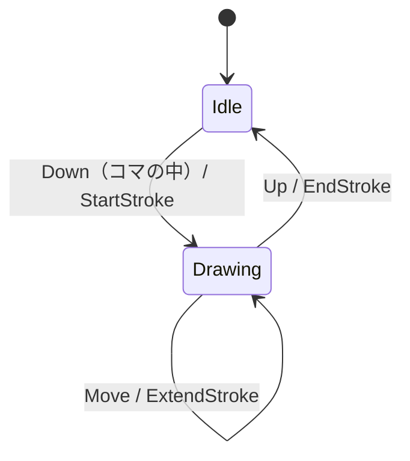
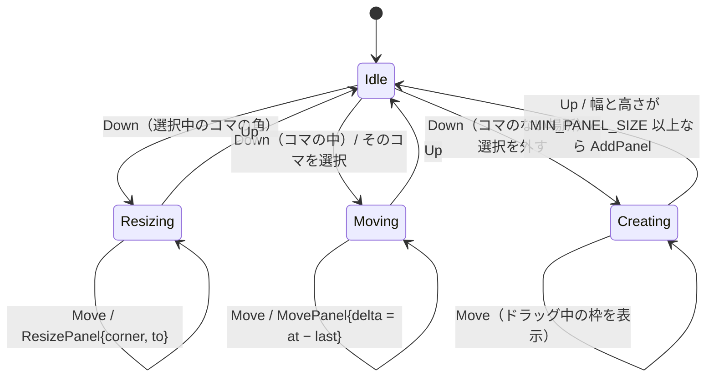

# ui-egui：画面

| 項目 | 内容 |
| --- | --- |
| クレート | `crates/ui-egui` |
| 依存してよい先 | domain、app、eframe（egui）、image、rfd |
| 対応する要件 | 仕様書 1〜8 章の画面と操作すべて |

## 1. 責務

- 画面を描き、マウス・キーボードの操作を受け取る。
- 操作を app の呼び出しに変える。作品のデータを直接書き換えない（必ず `Session::edit` などを通す）。
- 時間のかかる操作を作業スレッドで実行し、その間の画面を固まらせない。
- エラーを利用者向けの文にして表示する。

## 2. 構成

```
crates/ui-egui/src/
├── lib.rs          … run(workspace)：ウィンドウを開く
├── app.rs          … BunsanApp（eframe::App の実装）：画面全体の状態と毎フレームの処理
├── tools/          … 道具（egui に依存しない）
│   ├── mod.rs      … Tool トレイト、PointerEvent、ToolContext、ToolOutput
│   ├── pen.rs  eraser.rs  panel.rs  view.rs  asset.rs
├── canvas.rs       … キャンバスの描画と、マウス操作の座標変換
├── panels.rs       … メニューバー・ツールバー・履歴パネル・状態表示
├── dialogs.rs      … 作者・分岐名・アップロード先・競合の解決・素材一覧・素材 ID・閉じる確認
├── jobs.rs         … JobRunner（作業スレッド）
├── textures.rs     … TextureCache（素材の画像を egui のテクスチャにして保持）
├── messages.rs     … AppError → 利用者向けの文
└── fonts.rs        … 日本語フォントの読み込み
```

## 3. 型

### 3.1 画面全体の状態

```rust
pub struct BunsanApp {
    workspace: Workspace,
    session: Option<Session>,
    tool: Box<dyn Tool>,             // 選んでいる道具
    tool_kind: ToolKind,             // Pen / Eraser / Panel / View / Asset
    selection: Selection,            // 選択中のコマ・素材
    jobs: JobRunner,
    textures: TextureCache,
    dialog: Option<Dialog>,          // 開いているダイアログ
    status: String,                  // 状態表示
}

pub enum Selection { None, Panel(PanelId), Asset { panel: PanelId, index: usize } }
```

### 3.2 道具のインターフェース

道具は egui の型を使いません。`canvas.rs` が egui の入力をページ座標の `PointerEvent` に変えてから渡します。

```rust
pub enum PointerEvent {
    Down { at: Point },
    Move { at: Point },
    Up { at: Point },
    Wheel { at: Point, steps: f32 },     // 手前に回すと正
}

pub struct ToolContext<'a> {
    pub work: &'a Work,
    pub selection: &'a Selection,
    pub tolerance: f32,                  // 角や操作点をつかめる距離（ページ座標）。画面上の 8 px を換算した値
}

pub struct ToolOutput {
    pub commands: Vec<EditCommand>,      // Session::edit に渡す
    pub selection: Option<Selection>,    // 選択を変えるとき
}

pub enum Overlay { DragRect(Rect), Handles(Rect), EraserCircle { at: Point, radius: f32 } }

pub trait Tool {
    fn on_pointer(&mut self, event: PointerEvent, ctx: &ToolContext) -> ToolOutput;
    fn on_delete(&mut self, ctx: &ToolContext) -> ToolOutput;     // Delete キー
    fn overlay(&self, ctx: &ToolContext) -> Vec<Overlay>;          // ドラッグ中の枠などの表示
}
```

| 実装 | 道具 | 出す編集コマンド |
| --- | --- | --- |
| `PenTool` | ペン | `StartStroke`・`ExtendStroke`・`EndStroke` |
| `EraserTool` | 消しゴム | `Erase` |
| `PanelTool` | コマ | `AddPanel`・`MovePanel`・`ResizePanel`・`RemovePanel`（読み順は履歴パネル横のボタンで `ReorderPanel`） |
| `ViewTool` | 表示範囲 | `PanView`・`ZoomView` |
| `AssetTool` | 素材 | `MoveAsset`・`ScaleAsset`・`RemoveAsset` |

### 3.3 作業スレッド

```rust
pub struct JobRunner {
    sender: Sender<Box<dyn FnOnce() -> JobResult + Send>>,
    receiver: Receiver<JobResult>,
    running: Option<&'static str>,       // 実行中の操作の名前（状態表示用）
}

pub enum JobResult {
    Uploaded(Result<(), AppError>),
    DownloadedMore(Result<IntegrateOutcome, AppError>),
    InitialDownloaded(Result<Session, AppError>),
    Published(Result<AssetTicket, AppError>),
    Fetched(Result<AssetInfo, AppError>),
}
```

## 4. アルゴリズム

### A27. 道具の状態遷移

各道具は、ドラッグの途中の状態を持つ小さな状態機械です。

**ペン**



**消しゴム**：`Down` で `last = at`。`Move` のたびに `Erase{ panel: panel_at(at), from: last, to: at }` を出し、`last = at`。`Up` で終わる。

**コマ**



**表示範囲**：`Down`（コマの中）で `Panning`。`Move` のたびに `PanView{ delta = at − last }`。`Wheel` で `ZoomView{ factor = 1.1^steps, anchor = at }`。

**素材**：選択中のコマの素材について、角の近くなら `Scaling`（`ScaleAsset`）、素材の上なら `Moving`（`MoveAsset`）。`Delete` で `RemoveAsset`。

道具はマウスの位置しか扱わないため、テストではページ座標の `PointerEvent` の列を与え、返ってくる `EditCommand` の列を確かめます。

### A28. バックグラウンド処理

```
毎フレーム（update）:
    while let Ok(result) = jobs.receiver.try_recv():
        running = None
        match result:
            DownloadedMore(Ok(outcome)) → session.finish_download_more(outcome); 競合なら競合ダイアログを開く
            InitialDownloaded(Ok(s))    → session = Some(s)
            Published(Ok(ticket))       → 素材 ID ダイアログに ticket.text を表示
            Fetched(Ok(info))           → 状態表示「素材を受け取りました」
            Err(e)                      → status = messages::describe(e)
    if running が Some:
        編集・履歴の操作を受け付けない（キャンバスとボタンを無効にし、状態表示に「〜中…」）
        ctx.request_repaint_after(100 ms)      // 結果が届いたらすぐ反映するため
```

```
アップロードを押したとき:
    job = session.prepare_upload()?            // 画面スレッドで保存まで済ませる
    jobs.submit(move || JobResult::Uploaded(job.run()))
    running = Some("アップロード")
```

作業スレッドは 1 本で、操作は 1 つずつ実行します。実行中に同じ作品の別の操作を受け付けないので、作業フォルダを同時に書き換えることはありません。

### A29. キャンバスの描画

```
draw_canvas(ui):
    viewport = Viewport::fit(work.page, キャンバスの長方形)
    ページを白で塗る
    for (number, panel) in work.layout.panels を読み順に:
        frame_s = viewport で panel.frame を画面座標にした長方形
        clip = painter を frame_s で切り抜いたもの
        content = work.contents[panel.id]
        for asset in content.assets:                        // 素材が下
            rect = asset の長方形を コマ内容 → ページ → 画面 の順に変換
            clip.image(textures.get(asset.hash), rect)
        for stroke in content.strokes:                      // 線が上
            points = 各点を コマ内容 → ページ → 画面 の順に変換
            width  = STROKE_WIDTH × view.scale × viewport.k  // 太さはコマ内容の単位で固定（拡大すると太く見える）
            clip.line(points, width, 黒)
        painter で frame_s の枠線を描く
        frame_s の左上に読み順の番号（number + 1）を描く
    for overlay in tool.overlay(ctx): 表示する                // ドラッグ中の枠・操作点・消しゴムの円
```

`STROKE_WIDTH` は 4.0（0.4 mm）です。v0.1.0 の作品は小さいので、毎フレームすべてを描き直します。

### A30. テクスチャの保持

```
TextureCache::get(hash):
    if map に hash がある: return map[hash]
    bytes = session.asset_bytes(hash)       // 作品フォルダ → 素材置き場の順に探す
    image = PNG として読み込み、egui の画像（ColorImage）にする
    texture = ctx.load_texture(hash, image)
    map[hash] = texture
    return texture
```

同じハッシュ値の素材は中身が同じなので、一度作ったテクスチャを使い回せます。v0.1.0 では捨てずに持ち続けます。

## 5. エラーの文

`messages::describe(error) -> String` で、エラーを利用者向けの文に変えます。

| エラー | 文 |
| --- | --- |
| `Vcs(NotInstalled)` | Git が見つかりません。Git をインストールしてから起動し直してください。 |
| `IdentityRequired` | （作者名とメールアドレスを尋ねるダイアログを開く） |
| `UnrecordedChanges` | 履歴更新していない変更があります。先に履歴更新してください。 |
| `Vcs(UploadRejected)` | アップロード先に新しい履歴があります。先に継続ダウンロードしてください。 |
| `Vcs(Network(_))`・`Exchange(Unreachable)` | 相手につながりませんでした。接続先と、相手のアプリケーションが起動しているかを確かめてください。 |
| `Exchange(InvalidTicket)` | 素材 ID の形式が正しくありません。 |
| `Exchange(HashMismatch)`・`TicketMismatch` | 受け取ったデータが素材 ID と一致しないため、破棄しました。 |
| `Library(NotPng)` | PNG 画像だけを素材にできます。 |
| `ReadOnly` | 過去の状態を表示中は編集できません。「今の状態に戻る」を押してください。 |
| その他 | 「〜できませんでした」と、エラーの詳細 |

## 6. そのほか

- **日本語フォント**：起動時に `C:\Windows\Fonts\YuGothM.ttc`、なければ `meiryo.ttc` を読み込んで設定する。
- **ウィンドウのタイトル**：保存していない変更があるとき、末尾に「*」を付ける（`session.is_dirty()`）。
- **閉じるとき**：保存していない変更があれば、閉じる要求を取り消して確認ダイアログを出す。
- **起動時**：`workspace.check_environment()` が失敗したら、Git のインストールを案内する画面を出す（R-101）。

## 7. テスト

| 確かめること | 方法 |
| --- | --- |
| 各道具の状態遷移 | `PointerEvent` の列を与え、返る `EditCommand` を確かめる |
| 小さすぎるドラッグでコマができない | 同上 |
| エラーの文 | `describe` の単体テスト |
| 画面全体 | 手動で、完成の定義（要件定義書 2 章）の流れを通す |
