# シーケンス図

主な操作で、どの部品がどの順番で呼ばれるかを示します。部品の詳細は [modules/](modules/) にあります。

図の参加者は次のとおりです。

| 参加者 | クレート | 種類 |
| --- | --- | --- |
| UI | ui-egui | 画面 |
| Tool | ui-egui（`Tool` の実装） | 道具 |
| Jobs | ui-egui（`JobRunner`） | 作業スレッド |
| WS / Session / Assets | app（`Workspace`・`Session`・`AssetService`） | ユースケース |
| Work | domain | データと純粋な処理 |
| Repo | store-json（`WorkRepository` の実装） | アダプター |
| Files | fs（`FileSink` の実装） | アダプター |
| Vcs | vcs-git（`VersionControl` の実装） | アダプター |
| Lib | fs（`AssetLibrary` の実装） | アダプター |
| Ex | exchange-iroh（`AssetExchange` の実装） | アダプター |

app から右側の参加者への呼び出しは、すべて ports のトレイトを通ります。

## 目次

| 図 | 操作 | 要件 |
| --- | --- | --- |
| [S1](#s1-起動と新しい作品) | 起動と新しい作品 | R-050・R-101 |
| [S2](#s2-線を引く) | 線を引く | R-001 |
| [S3](#s3-線を消す) | 線を消す | R-002 |
| [S4](#s4-コマを動かして保存する) | コマを動かして保存する | R-011・R-014・R-051 |
| [S5](#s5-履歴更新) | 履歴更新 | R-040 |
| [S6](#s6-過去の状態を見る) | 過去の状態を見る | R-041・R-042 |
| [S7](#s7-この状態に戻す) | この状態に戻す | R-042 |
| [S8](#s8-分岐と切り替え) | 分岐と切り替え | R-043 |
| [S9](#s9-統合競合あり) | 統合（競合あり） | R-044 |
| [S10](#s10-素材を公開する) | 素材を公開する | R-030 |
| [S11](#s11-素材を受け取る) | 素材を受け取る | R-031・R-032 |
| [S12](#s12-素材を貼って保存する) | 素材を貼って保存する | R-020・R-022 |
| [S13](#s13-アップロードと継続ダウンロード) | アップロードと継続ダウンロード | R-045 |
| [S14](#s14-初回ダウンロード) | 初回ダウンロード | R-045 |

## S1. 起動と新しい作品

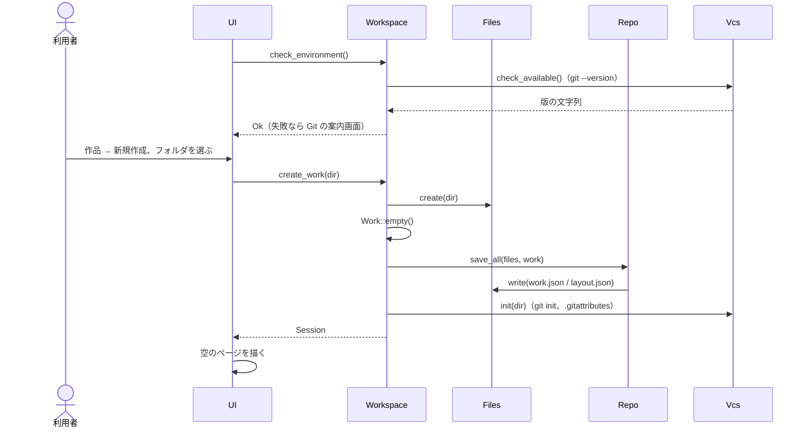

## S2. 線を引く

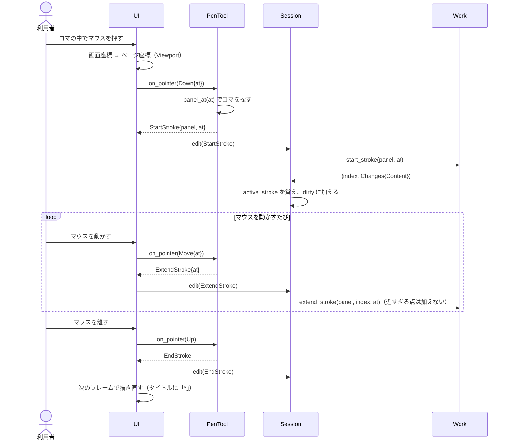

## S3. 線を消す

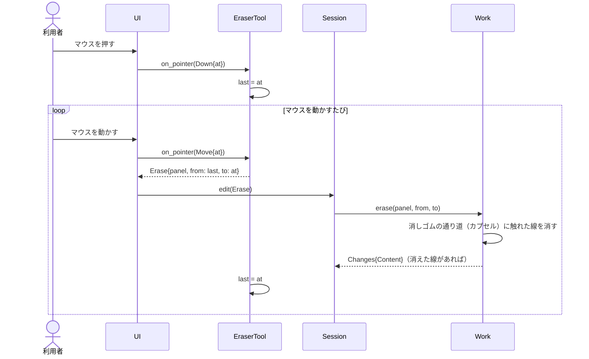

## S4. コマを動かして保存する

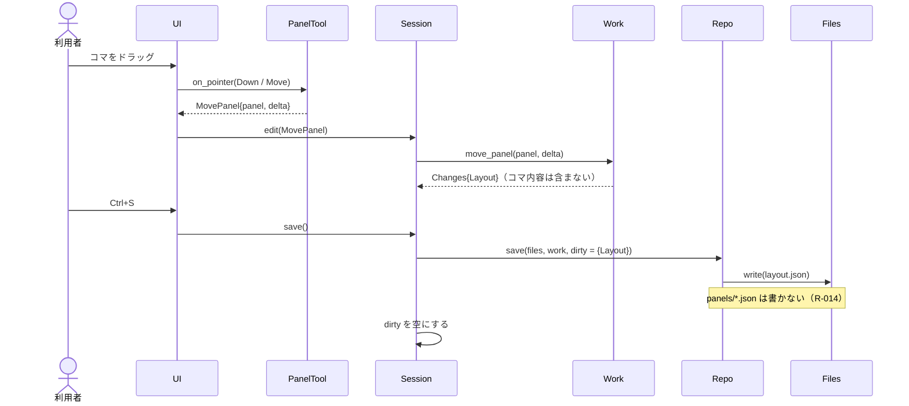

## S5. 履歴更新

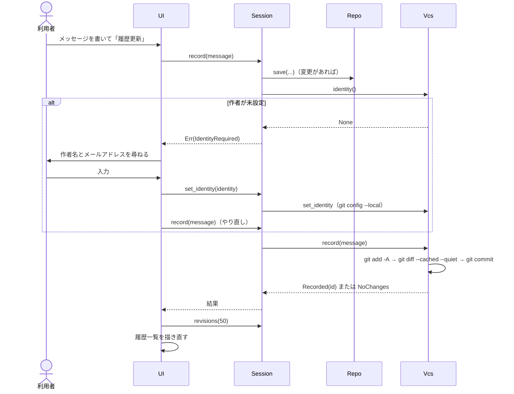

## S6. 過去の状態を見る

vcs-git と store-json は互いを知りません。app が、vcs-git の `FileSource`（過去のファイルを読む手段）を store-json に渡して組み合わせます。

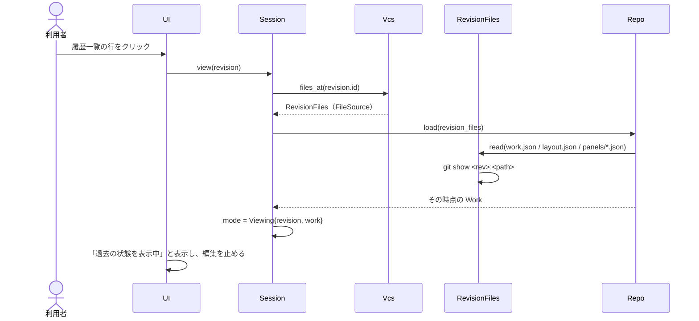

## S7. この状態に戻す

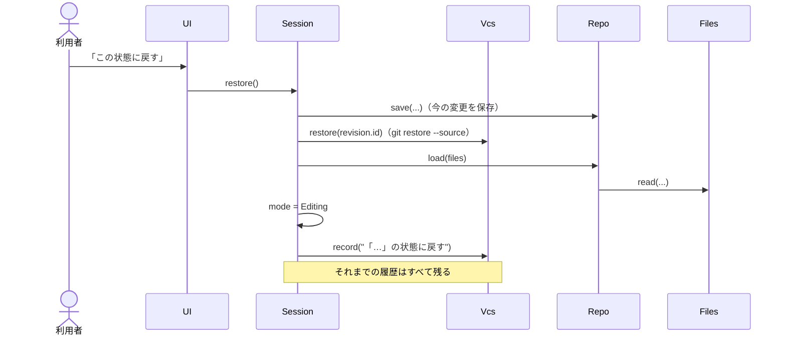

## S8. 分岐と切り替え

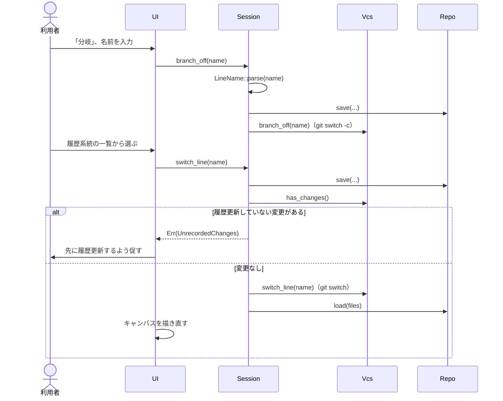

## S9. 統合（競合あり）

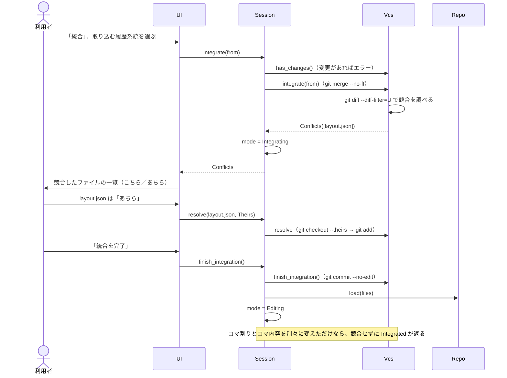

## S10. 素材を公開する

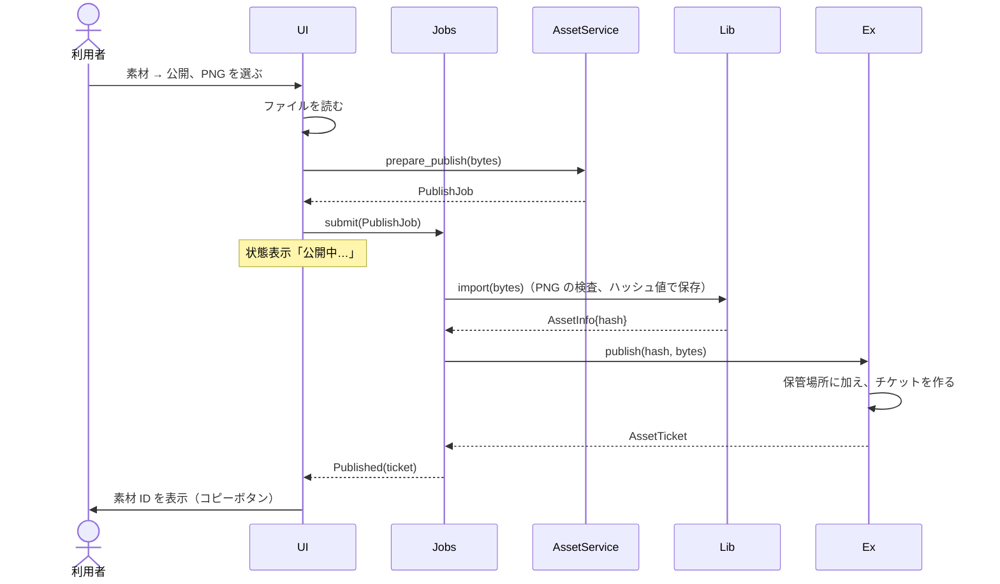

## S11. 素材を受け取る

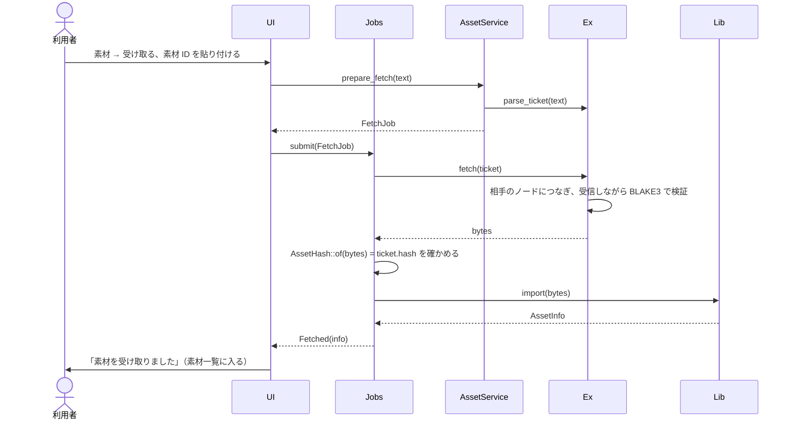

## S12. 素材を貼って保存する

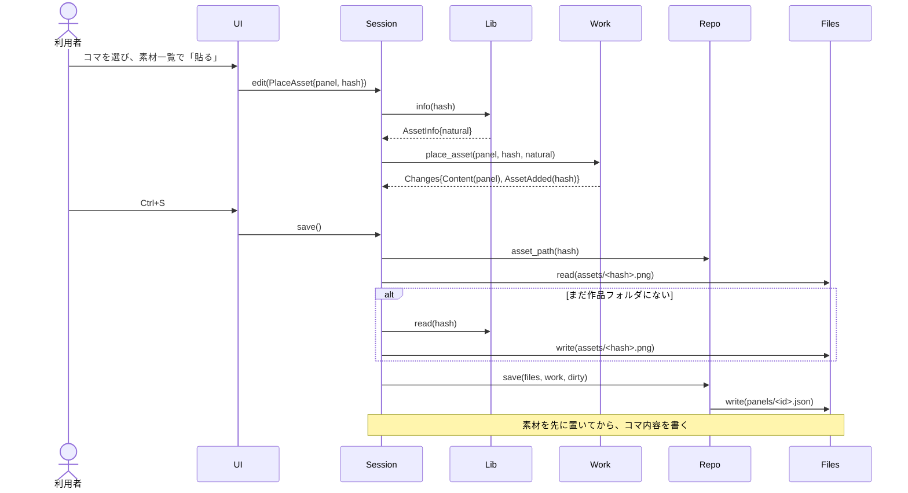

## S13. アップロードと継続ダウンロード

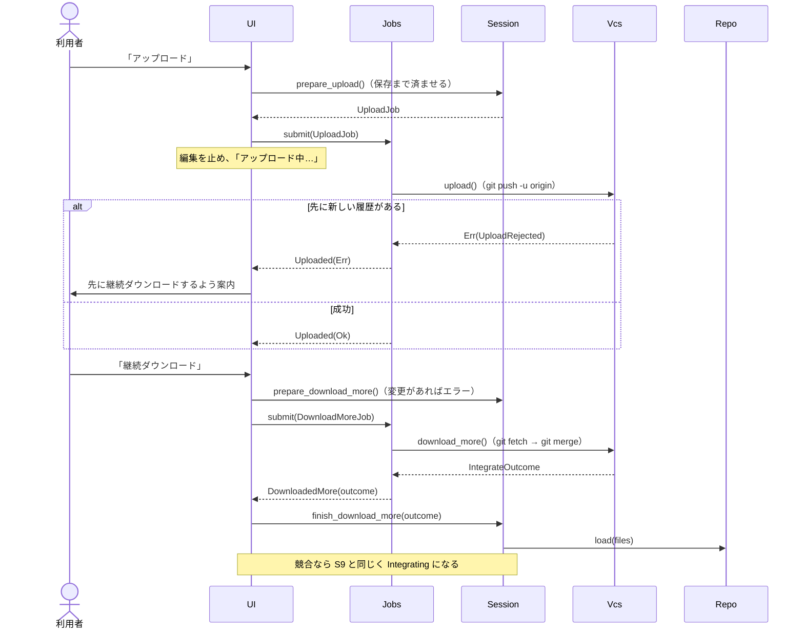

## S14. 初回ダウンロード

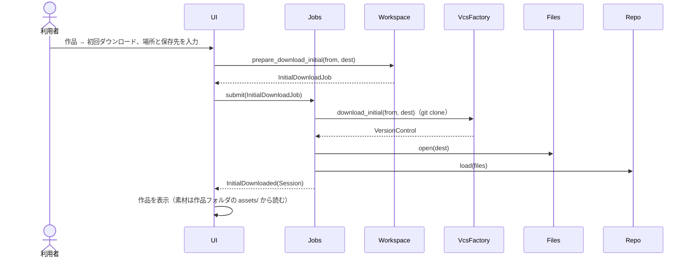
